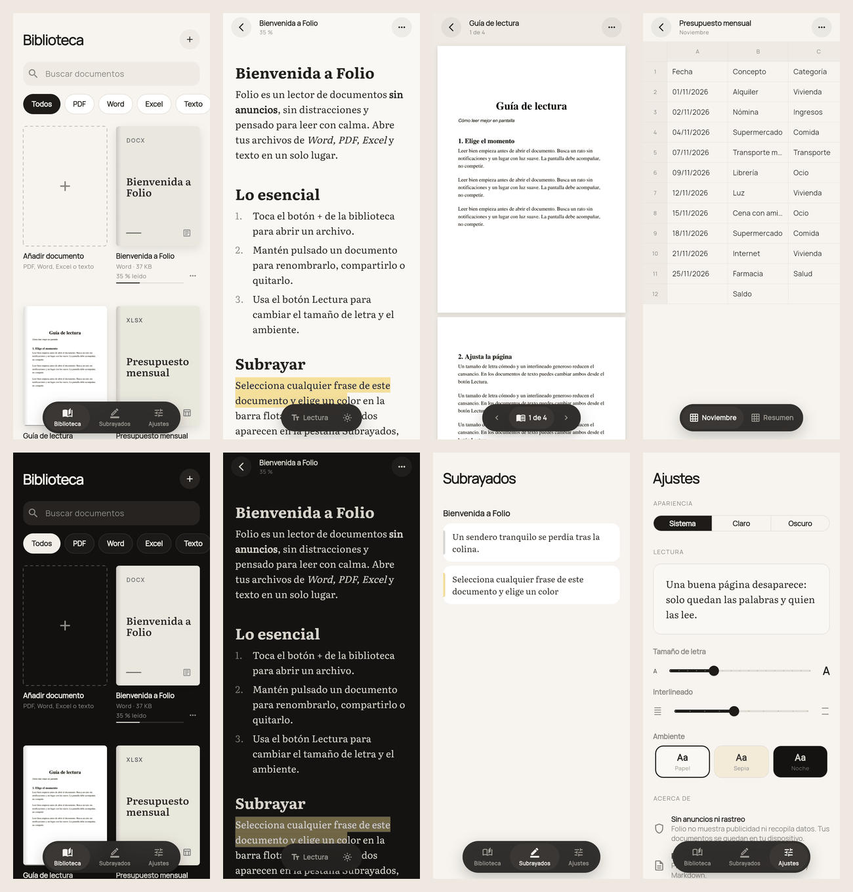

# Folio

Lector de documentos para Android e iOS hecho con Flutter: **PDF, Word,
Excel, CSV, TXT, Markdown, RTF, EPUB e imágenes** en una sola app, **sin anuncios, sin rastreo y
sin conexión**.



## Qué hace

- **Biblioteca** en cuadrícula con portadas (primera página para PDF,
  portada tipográfica para el resto), búsqueda sin tildes y filtros por tipo.
- **Lector de texto** (Word, TXT, Markdown) con tipografía serif, tamaño e
  interlineado ajustables y ambientes Papel, Sepia y Noche.
- **Subrayados** de cuatro colores al seleccionar texto, reunidos en su
  propia pestaña.
- **PDF** con zoom, selección de texto e ir a página.
- **Hojas de cálculo** con cabeceras fijas, varias hojas y fechas/números
  formateados.
- Recuerda por dónde ibas en cada documento.
- Tema claro/oscuro y textos en español e inglés.

## Empezar

```bash
flutter pub get
flutter run
```

Requiere Flutter 3.50 (Dart 3.14) o superior.

Para Android, instala también el **NDK 28.2.13676358** (lo pide `pdfrx`):
Android Studio → SDK Manager → SDK Tools → NDK (Side by side), o
`sdkmanager "ndk;28.2.13676358"`.

Si el demonio de Gradle se cae por memoria, ciérralo y vuelve a lanzar:

```bash
cd android && ./gradlew --stop && cd ..   # en Windows: .\gradlew --stop
flutter run
```

## Desarrollo

- Reglas y comandos: [`CLAUDE.md`](CLAUDE.md)
- Arquitectura: [`docs/ARCHITECTURE.md`](docs/ARCHITECTURE.md)
- Sistema de diseño: [`docs/DESIGN.md`](docs/DESIGN.md)
- Skills para Claude Code en `.claude/skills/` (añadir formato, nueva
  funcionalidad, revisar UI) y un agente revisor en `.claude/agents/`.

```bash
dart format lib test && flutter analyze && flutter test
```

## Licencias

Código bajo la licencia del repositorio. Tipografías Manrope, Literata y
JetBrains Mono bajo SIL Open Font License 1.1
(`assets/google_fonts/OFL.txt`).
